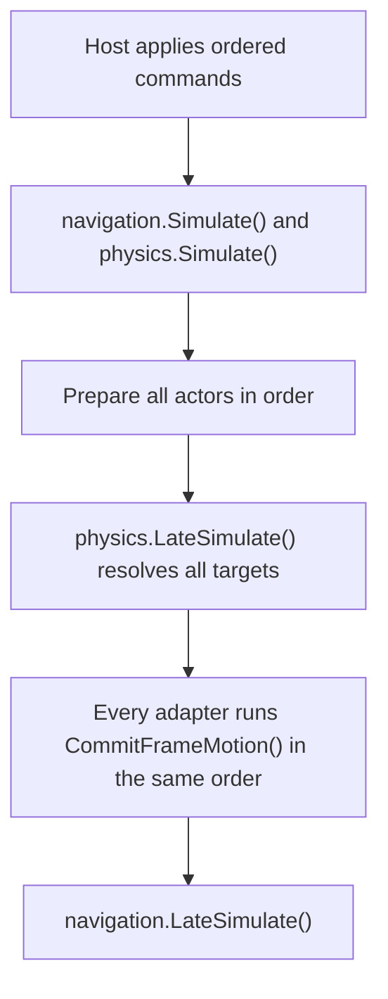

# Gravitas integration

`Trailblazer.Gravitas` connects Trailblazer's Navigators to host-owned
Gravitas kinematic bodies. Trailblazer requests movement, Gravitas resolves
collisions, and the adapter commits the accepted pose. The core packages remain
independent.

Use the standard adapter with standard LSF dependencies, or
`Trailblazer.Gravitas.Lean` with an entirely Lean stack. Both expose
`GravitasNavigator2D` and `GravitasNavigator3D` in `Trailblazer.Navigation`
and target `netstandard2.1` and `net10.0`. The Lean family omits MemoryPack
and uses the same physics behavior.

Repository builds and package validation are documented in the
[adapter README](https://github.com/mrdav30/Trailblazer/blob/main/src/Trailblazer.Gravitas/README.md).

## Who owns what?

| Owner       | Responsibility                                                                                                                   |
| ----------- | -------------------------------------------------------------------------------------------------------------------------------- |
| Host        | One `GridWorld`, deterministic commands, transforms, bodies, colliders, actor order, terrain/map authoring, and gameplay actions |
| Trailblazer | Guidance, steering, turning, requested locomotion/gravity/platform motion, and accepted-motion navigation state                  |
| Gravitas    | Physical collision resolution and the accepted body pose                                                                         |
| Adapter     | Target-pose preparation, support sampling, and one accepted-motion commit                                                        |

Attach both contexts to the same host-owned world with `takeOwnership: false`.
Use the same fixed frame rate and advance them together. Register the grids
before colliders; publish maps and policies before submitting guided requests.
Map clearance describes navigability—it does not create a physical collider.

Each context owns its own Chronicler clock. Both expose long frame counts and
wide elapsed timestamps while retaining Fixed64 integration steps. The adapter
does not advance either clock, synchronize their rates, or repair a missed step.
If the host changes the rate, change both at the same fixed-step boundary.
Resetting one context does not reset the other; coordinate both resets and
controller/body reconstruction explicitly. Numeric frame counts need not match
if world preparation advanced one context earlier, but every gameplay step must
use the same duration and the barrier below.

## Configure the body and Navigator

The host implements Gravitas `IMatterAgent`, supplying its context and
`FixedTransform`. Create an active, kinematic 3D `SolidBody` with
`ContinuousCollisionMode.Continuous`, zero Gravitas `GravityScale`, and
`UseManualGrounding()`. Trailblazer owns the gravity and platform contributions.
Do not also apply Gravitas ground snap, a second gravity calculation, or a
second platform velocity transfer.

Create `GravitasNavigator3D` with that body and the same-world Trailblazer
context. Supply the support layer mask, positive sweep radius/distance, and
non-negative foot-relative origin offset. Then call `Setup(...)` with a matching
`NavigationAgentProfile` and body pose, followed by `Initialize(...)` with the
host's initial traversal condition. Configure motor behavior before movement.
The adapter validates an active kinematic body, but does not author its shape,
collision layers, CCD mode, or matching navigation clearance for you.

The verified moving actors use centered spheres and upright capsules. These are
separate from the cylindrical navigation clearance description; configure both
deliberately. Other Gravitas shapes retain their own collision/CCD limits and
are not automatically certified character-controller shapes by this adapter.

## One fixed frame

Advance each context once and prepare every kinematic target before the single
physics resolution. For 3D actors, prepare by calling `Simulate()` on each
adapter. During commit, each adapter reads the accepted pose, samples
support, and finalizes navigation. Read committed cells and publish presentation
snapshots after `navigation.LateSimulate()`.

Do not resolve physics separately for each agent. Do not multiply the requested
displacement by delta time again. Do not first commit the requested pose and
then overwrite it with a collision correction. The accepted position, rotation,
velocity, and committed navigation cell must describe the same movement.

For `GravitasNavigator3D`, duplicate prepare, commit without prepare, duplicate
commit, and commit after the Trailblazer frame advances or its clock resets
throw before accepted motion changes. The host must finish physics late
resolution before calling commit. A failed/discarded
physics frame invalidates that authoritative frame. Reset is not rollback;
restore a complete host checkpoint or rebuild the affected simulation before
continuing.

## Native planar bodies

Attach a `GravitasNavigator2D` to an active kinematic `SolidBody2D` in a
`PhysicsRuntimeMode.TwoD` context. Give the physics transform no parent and
unit X/Z scale. Publish a planar map matching the profile's mode and bind a
centered `LSCircleCollider2D` for top-down or a centered upright
`LSCapsuleCollider2D` for side-view. The capsule's full height is its axis
length plus twice its radius. Configure continuous collision detection for
kinematic motion that must clip at blockers.

Planar `Vector2d.X` and `Vector2d.Y` map to world X and Z. Positive planar
rotation turns from Right toward Forward. The adapter preserves the physics
transform's world Y, while navigation uses the map's embedding Y for occupancy.
Use the shared frame order above. In the prepare step, call
`PrepareFrameMotion()` for guidance or supply a manual planar input. The
planar adapter checks for one collision-distribution pass on the prepared
physics frame. The host must wait
for `physics.LateSimulate()` to return successfully before committing any actor.

Side-view needs a positive `supportProbeDistance`. The probe starts at the
accepted lower cap center and sweeps toward negative planar Y. Gravitas applies
its physical collision filters and the supplied layer mask, which defaults to
all layers. The result carries the actual surface point, normal, and material
friction. Call `RefreshSupport()`
between frames after construction, restore, or successful posture replacement.
An optional carrier lookup supplies a positive host-stable ID and registration
lifetime. Publish carrier poses before rider preparation so Trailblazer can
apply the difference from the previously committed support pose exactly once.

Between frames, `TryReplaceNavigationProfile(...)` checks navigation clearance
and native collider fit in the same transaction. Side-view replacement preserves
the nominal foot. The [wall and shared-step tests](https://github.com/mrdav30/Trailblazer/blob/develop/tests/Trailblazer.Gravitas.Tests/Planar/GravitasNavigator2D.AcceptedMotion.Tests.cs)
and [support and posture tests](https://github.com/mrdav30/Trailblazer/blob/develop/tests/Trailblazer.Gravitas.Tests/Planar/GravitasNavigator2D.Support.Tests.cs)
show the setup and calls for both modes.

## Contacts and moving platforms

After resolution, the 3D adapter sweeps a sphere downward from the accepted foot
plus the configured origin offset. It excludes the mover and uses the supplied
support mask. The closest hit must have a positive-Y normal and a representable
contact point; otherwise the Navigator reports airborne. This is a support
sample, not ground snapping or an extra collision solver.

Use non-trigger support geometry on those layers. Closest-hit distance and
Gravitas collider-ID ordering decide ties. A nearer unsuitable hit is not
skipped to search for a different floor. Physical collision filtering and
support-query filtering are distinct: including a floor in the support mask does
not make the actor collide with it.

Support preserves the actual world-space normal independently from the carrier
transform. An optional `carrierIdResolver` returns a stable positive host ID for
a moving platform; zero means inert support, and negative values reject. Do not
use context-local collider IDs as persistent platform identity. Publish platform
motion through the same fixed frame order and let Trailblazer apply carry once.

Requested/accepted pose divergence is the adapter's obstruction signal. Generic
collider callbacks are not treated as obstructions because they cannot
distinguish a supporting floor from a blocking wall.

## Collision and traversal limits

The contract is **stop at a blocker, accept an explicitly requested tangent, and
resolve host-authored step/action movement**. It is not an automatic wall-slide
or general-purpose step-up solver. CCD limits and unsupported shape pairs remain
Gravitas limits; conservative clipping does not mean a route is unreachable or a
gameplay action succeeded.

Ladders, jumps, and other semantic actions remain host owned. Approach the exact
surfaced action, perform bounded physical movement, and complete its exact
instruction only after the accepted pose satisfies the action. A blocked climb
must not be reported complete just because the requested target was valid. See
[Transitions](Transitions.md) and [Path Guides](PathGuides.md).

## Change posture and restore state

For 3D posture changes, call `TryReplaceNavigationProfile(...)` at a safe
frame boundary. The adapter supports coordinated replacement only for
unit-world-scale `LSCapsuleCollider` bodies with positive radius and height at
least twice the radius. It preserves the foot anchor, checks navigation and
physical fit, and publishes the capsule plus profile before physical separation
callbacks observe them. A rejected growth leaves both live shapes unchanged. Do
not resize the collider independently and then try to repair navigation.

Restore the host world/settings, maps/policies, platform transforms, and
physical body/collider first. Publish each restored bodyless platform pose to
its collider before applying the first resumed platform command. For a host
transform edit, `collider.Simulate()` publishes the geometry and partition
immediately. CCD runs before the usual bodyless partition refresh during
`LateSimulate()` and uses the committed pose.

Set up a Navigator shell with the recorded profile, then populate it through
Chronicler. Successful population clears adapter-local prepared motion and
cached support. The next complete frame samples support and rebuilds transient
guidance. Rejected population preserves a valid prepared frame. JSON and
standard-family MemoryPack follow the same ownership boundary. See
[Serialization](Serialization.md) for the full load contract.

For teardown, reset each Navigator, deactivate its host-owned body and any
bodyless colliders, dispose both contexts, and dispose the shared world last.
`Reset()` releases Navigator registrations and guidance; it does not dispose
physics objects. Setup and initialize again before reusing the adapter.

Rendering, interpolation, debug drawing, and animation remain presentation-only.
They may observe accepted state but must never feed interpolated poses back into
the lockstep simulation.
