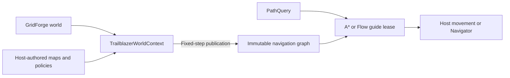

# Trailblazer Guides

Trailblazer is deterministic, engine-agnostic navigation for lockstep games and
simulations. It combines GridForge-backed navigation maps, A* and flow fields,
explicit traversal actions, steering, turning, locomotion, and serialization
without taking ownership of your engine or gameplay systems.

The guides describe the integration steps and ownership rules. For exact type
and member signatures, see the [public API reference](xref:Trailblazer).

## Start here

New to Trailblazer? Follow this path:

1. Install a package, publish a small world, and request a route.
   [Getting Started](GettingStarted.md)
2. Learn which state Trailblazer owns and where the host participates.
   [Technical Overview](Overview.md)
3. Understand physical cells, navigation meaning, defaults, and overlays.
   [Navigation Maps](NavigationMaps.md)
4. Build queries and consume A* or Flow results. [Pathing](Pathing.md),
   [Path Guides](PathGuides.md)

## Find the right guide

| I want to...                                     | Read...                                                       |
| ------------------------------------------------ | ------------------------------------------------------------- |
| Build or import navigation data                  | [Map Authoring](MapAuthoring.md)                              |
| Publish maps, policies, or runtime changes       | [Map Publication](MapPublication.md)                          |
| Route through Gas or Liquid                      | [Volume Traversal](VolumeTraversal.md)                        |
| Add ladders, jumps, takeoff, or teleporters      | [Transitions](Transitions.md)                                 |
| Drive a complete controller                      | [Navigator](Navigator.md)                                     |
| Resolve controller motion through Gravitas       | [Gravitas integration](Gravitas.md)                           |
| Customize steering or facing                     | [NavSteering](NavSteering.md) and [NavTurning](NavTurning.md) |
| Configure movement, jumping, water, or platforms | [NavMotor](NavMotor.md) and [Gravity](Gravity.md)             |
| Use deterministic ground-height data             | [Heightmaps](HeightMaps.md)                                   |
| Save and restore runtime state                   | [Serialization](Serialization.md)                             |
| Diagnose a failed query or stuck action          | [Troubleshooting](Troubleshooting.md)                         |

## From world geometry to movement

Trailblazer owns deterministic navigation meaning. Your host owns terrain
classification, collision detection, physics, animation, and gameplay actions.
Dispose leases and Navigators before disposing their context.

## Project links

- [GitHub repository](https://github.com/mrdav30/Trailblazer)
- [Trailblazer on NuGet](https://www.nuget.org/packages/Trailblazer)
- [Trailblazer.Lean on NuGet](https://www.nuget.org/packages/Trailblazer.Lean)
- [Coverage report](https://mrdav30.github.io/Trailblazer/coverage/)
- [Migration guide](https://github.com/mrdav30/Trailblazer/blob/main/docs/MIGRATION.md)
- [Contributor workflow and repository boundaries](https://github.com/mrdav30/Trailblazer/blob/main/AGENTS.md)
